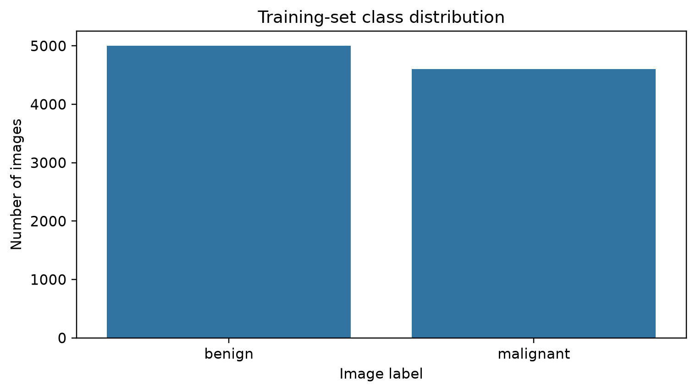
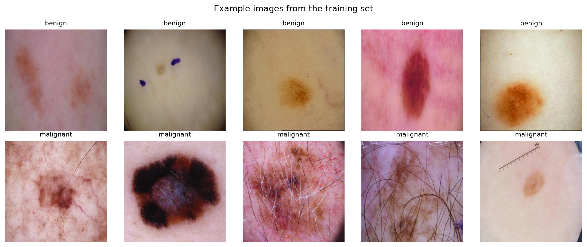
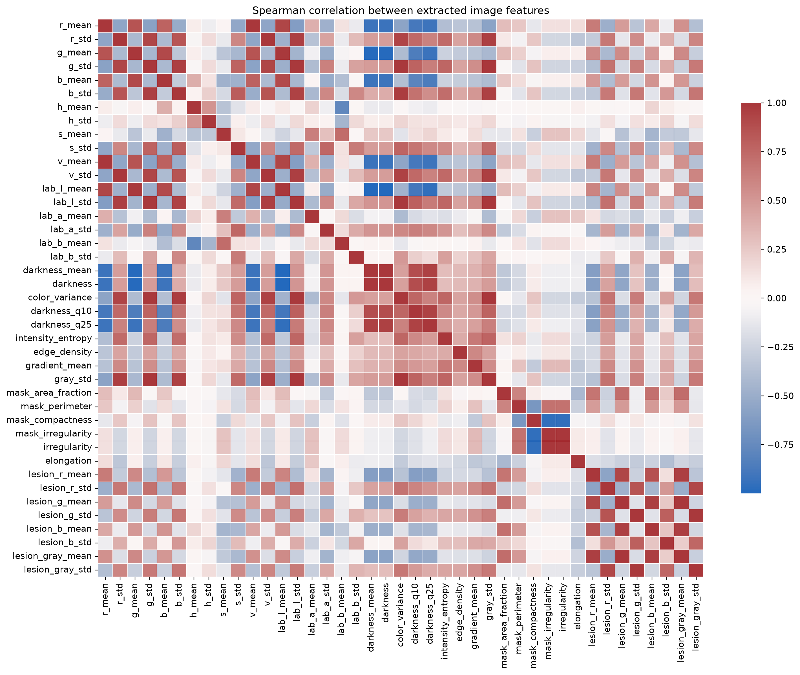
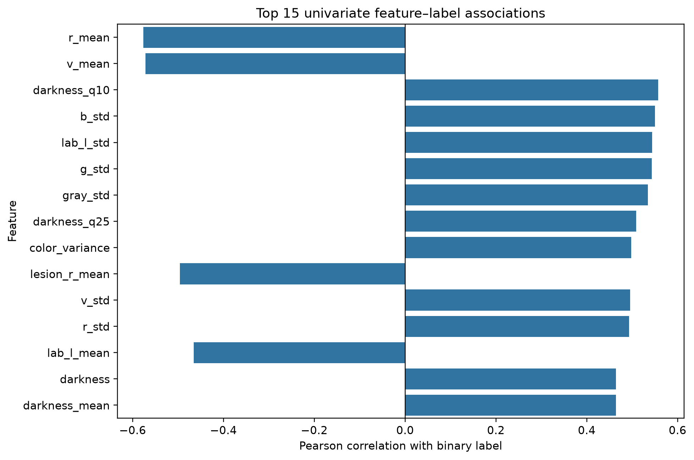
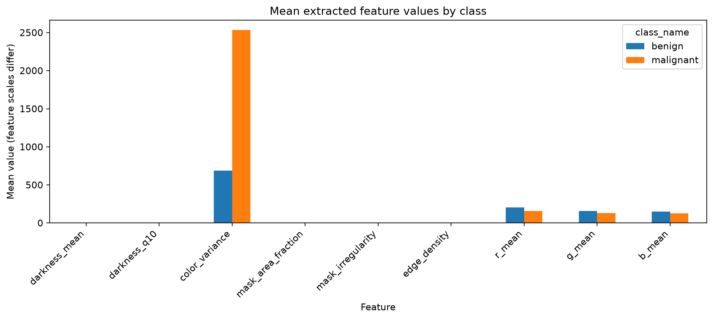
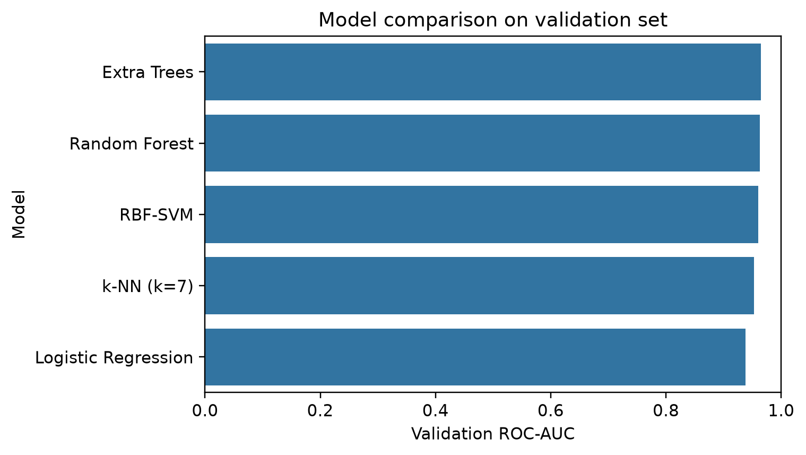
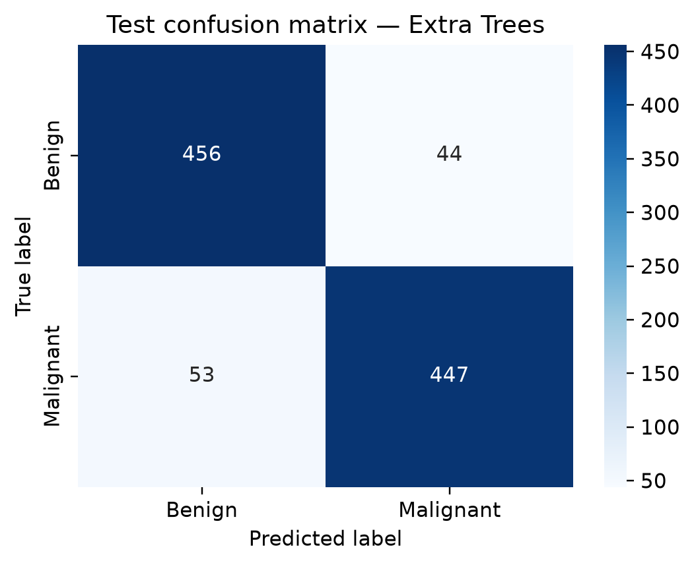
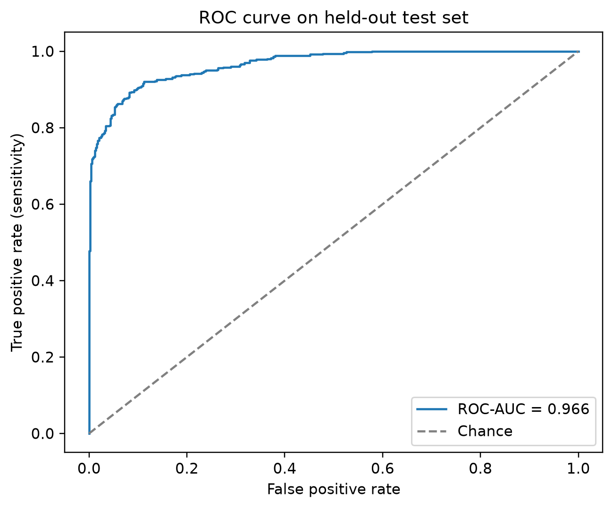
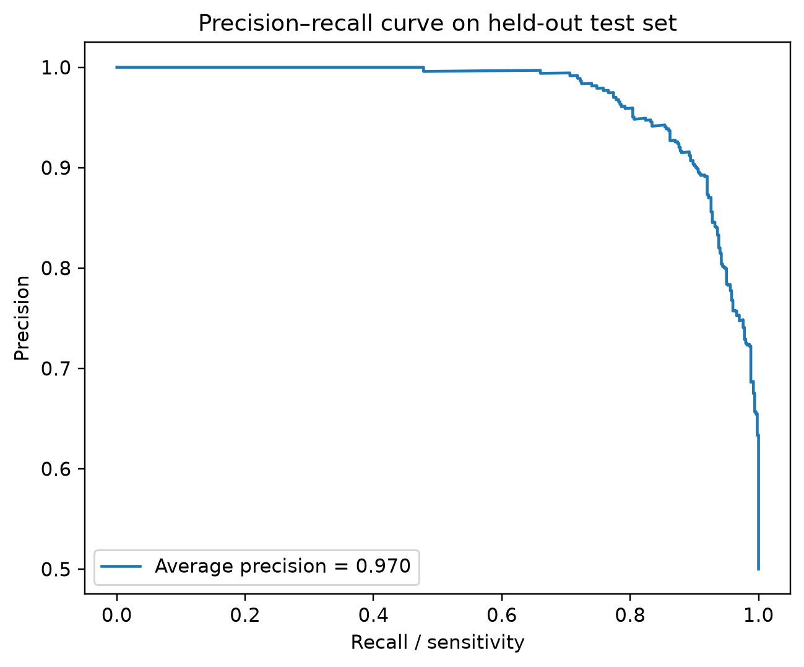
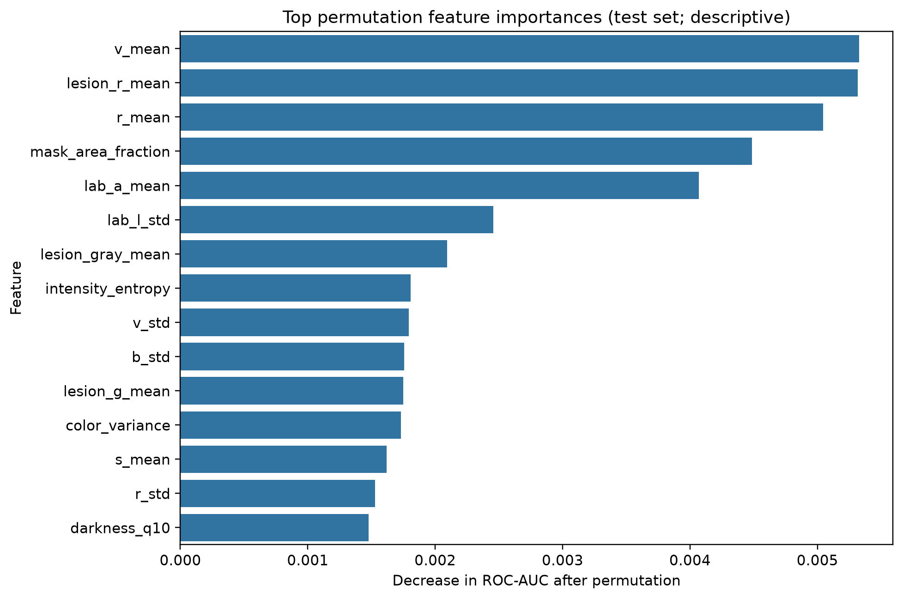

# Melanoma Detection Through Dermoscopic Image Analysis

**Machine Learning · Medical Imaging · Computer Vision · Healthcare AI**

An exploratory machine learning project focused on classifying dermoscopic images into benign and malignant categories using image processing, handcrafted feature extraction, statistical analysis and supervised learning.

> **Disclaimer:** This is an educational and research-oriented project. It is not a medical diagnostic system and must not be used to make clinical decisions.

---
## 1. Project Overview

Melanoma is an aggressive form of skin cancer for which early detection is important.

This project explores how image processing and machine learning techniques can be applied to dermoscopic images to identify visual patterns associated with benign and malignant skin lesions.

The workflow combines image analysis, handcrafted feature extraction, exploratory data analysis and supervised classification.

The main objectives are to:

- Explore and characterize a dermoscopic image dataset.
- Extract numerical features from medical images.
- Investigate colour, intensity, texture and shape descriptors.
- Analyse relationships between extracted features.
- Compare supervised machine learning algorithms.
- Evaluate model performance using multiple classification metrics.
- Discuss methodological limitations and potential sources of bias.

## 2. Dataset Description

The dataset contains **10,605 dermoscopic images**, divided into two categories: benign and malignant.

### Dataset distribution

| Dataset split | Benign | Malignant | Total |
|---|---:|---:|---:|
| Training | 5,000 | 4,605 | 9,605 |
| Testing | 500 | 500 | 1,000 |
| **Total** | **5,500** | **5,105** | **10,605** |

### Image characteristics

- Image format: JPEG
- Dimensions: 300 × 300 pixels
- Colour representation: RGB
- Classification categories: Benign and Malignant

The training set presents a moderate class imbalance, while the test set is balanced.

The original dataset is stored locally and is not included in this repository.

**Dataset provenance and redistribution licence must be verified before public redistribution.**

## 3. Methodology

The project follows several stages, from image exploration to model evaluation.

### Image preprocessing

The image-processing workflow includes:

- Image loading and validation.
- RGB, HSV and CIELAB colour-space analysis.
- Grayscale and intensity analysis.
- Heuristic foreground segmentation.
- Preliminary lesion-region descriptors.

The segmentation approach is exploratory and has not been clinically validated.

### Feature extraction and engineering

Each image is transformed into a numerical representation using handcrafted descriptors.

The extracted features include:

| Feature category | Examples |
|---|---|
| Colour | RGB, HSV and CIELAB statistics |
| Intensity | Brightness, darkness and intensity quantiles |
| Texture | Gradient magnitude, edge density and entropy |
| Statistical | Means and standard deviations |
| Shape | Area fraction, perimeter and compactness |
| Irregularity | Heuristic lesion-boundary descriptors |

The resulting feature table contains **10,605 image records**.

### Exploratory Data Analysis

Exploratory analysis was conducted to understand the dataset and investigate differences between the two image categories.

The analysis includes:

- Class distribution.
- Representative dermoscopic image visualisation.
- RGB colour comparisons.
- Spearman feature-correlation matrix.
- Feature-label associations.
- Class-wise feature distributions.
- Boxplots and comparative bar charts.

These analyses help identify relationships between extracted variables and potential feature redundancy.

Correlation does not establish causality or clinical relevance.

## 4. Machine Learning Models

Five supervised learning algorithms were compared:

| Model | Description |
|---|---|
| Logistic Regression | Linear classification baseline |
| k-Nearest Neighbours | Distance-based classification |
| Random Forest | Tree-based ensemble learning |
| RBF Support Vector Machine | Non-linear classification |
| Extra Trees | Randomized tree-based ensemble |

### Model selection strategy

The training dataset was divided into a training subset and a validation subset.

The models were compared using validation ROC-AUC.

The selected model was then refitted on the complete training set and evaluated on the held-out test set.

The test set was kept separate from model selection.

## 5. Experimental Results

The best-performing model selected during validation was the **Extra Trees Classifier**.

### Test-set performance

Evaluation was performed on 1,000 held-out images.

| Metric | Result |
|---|---:|
| Accuracy | 90.30% |
| Balanced Accuracy | 90.30% |
| ROC-AUC | 96.58% |
| Average Precision | 97.00% |
| Sensitivity (Malignant) | 89.40% |
| Specificity (Benign) | 91.20% |
| Precision (Malignant) | 91.04% |
| F1-score (Malignant) | 90.21% |

The model achieved a ROC-AUC of approximately 0.966, indicating strong discrimination between the two image classes on this particular test set.

### Confusion matrix

| Actual / Predicted | Benign | Malignant |
|---|---:|---:|
| Benign | 456 | 44 |
| Malignant | 53 | 447 |

The model correctly classified:

- 456 benign images.
- 447 malignant images.

It also produced:

- 44 false positives.
- 53 false negatives.

The 53 false negatives are particularly important to consider because they correspond to malignant-labelled images classified as benign.

Sensitivity is therefore an important metric when analysing this classification task.

### Model interpretation

The ROC-AUC measures the model's ability to rank malignant images above benign images across different classification thresholds.

The Precision-Recall curve provides complementary information about the relationship between precision and sensitivity.

The confusion matrix highlights the types of classification errors made at the selected threshold of 0.5.

These results represent exploratory image-level performance, not clinical performance or evidence of clinical effectiveness.

## 6. Visualisation and Analysis

The project generates visualisations covering the different stages of the workflow.

### Exploratory Data Analysis

**Class distribution**



**Representative dermoscopic images**



**Feature correlation matrix**



**Feature-label associations**



**Mean feature values by class**



### Model Evaluation

**Validation model comparison**



**Test confusion matrix — Extra Trees**



**ROC curve**



**Precision-Recall curve**



**Permutation feature importance**



Additional visualisations include RGB colour comparisons and individual feature distributions.

All generated figures are available in the `reports/figures/` directory.

## 7. Technologies and Tools

| Technology | Application |
|---|---|
| Python | Main programming language |
| NumPy | Numerical computation |
| Pandas | Data manipulation |
| OpenCV | Image processing |
| Matplotlib | Data visualisation |
| Seaborn | Statistical visualisation |
| Scikit-learn | Machine learning |
| SciPy | Scientific computation |
| Jupyter Notebook | Exploratory analysis |

## 8. Repository Structure

```text
melanoma-detection/
│
├── data/                         # Local dataset (not committed)
│
├── src/
│   ├── __init__.py
│   ├── features.py
│   └── train.py
│
├── notebooks/
│   └── 01_project_walkthrough.ipynb
│
├── reports/
│   ├── figures/
│   ├── image_features.csv
│   └── evaluation outputs
│
├── color_analysis.py
├── correlation_analysis.py
├── eda.py
├── feature_extraction.py
├── test_dataset.py
├── visualize_images.py
│
├── CITATION.md
├── README.md
├── requirements.txt
└── .gitignore
```

## 9. Installation and Reproducibility

### Clone the repository

```bash
git clone https://github.com/ami-nx23/melanoma-detection.git
cd melanoma-detection
```

### Create a virtual environment

```bash
python -m venv .venv
```

On Windows:

```powershell
.venv\Scripts\activate
```

### Install dependencies

```bash
pip install -r requirements.txt
```

### Prepare the dataset

Extract the dataset locally using the following structure:

```text
data/
└── archive/
    └── melanoma_cancer_dataset/
        ├── train/
        │   ├── benign/
        │   └── malignant/
        │
        └── test/
            ├── benign/
            └── malignant/
```

The dataset is excluded from version control through `.gitignore`.

### Run feature extraction

```bash
python feature_extraction.py
```

### Run the training pipeline

```bash
python -m src.train --data-dir data/archive/melanoma_cancer_dataset --output-dir reports
```

The pipeline generates evaluation metrics and visual outputs in the reports directory.

## 10. Limitations and Research Considerations

Several limitations must be considered when interpreting the results:

- The segmentation algorithm is heuristic and has not been clinically validated.
- Patient identifiers are unavailable, so patient-level separation cannot be guaranteed.
- Image acquisition conditions and lighting may introduce bias.
- The original dataset provenance and licence require verification.
- The model has only been evaluated on the supplied dataset.
- External validation is necessary to assess generalisation.
- Image-level performance does not establish clinical effectiveness.

The results should therefore be interpreted as an exploratory machine learning study rather than a validated medical application.

## 11. Future Research Directions

Potential extensions include:

- Exploring more advanced image segmentation methods.
- Comparing handcrafted features with deep learning representations.
- Implementing Convolutional Neural Networks.
- Investigating transfer learning with pretrained architectures such as EfficientNet.
- Evaluating model calibration and prediction uncertainty.
- Performing patient-level validation where identifiers are available.
- Testing on independent datasets.
- Investigating robustness across imaging conditions and populations.

## 12. Project Motivation

This project reflects an interest in the intersection of artificial intelligence, biomedical research and public health.

It provides practical experience in scientific programming, statistical analysis, computer vision and machine learning applied to healthcare-related data.

---

**Keywords:** Machine Learning · Medical Imaging · Melanoma · Computer Vision · Feature Engineering · Statistical Analysis · Healthcare AI · Python
